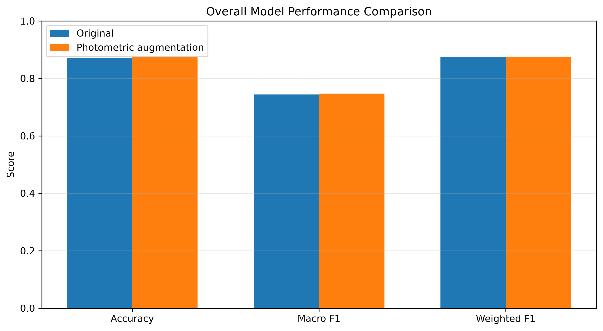
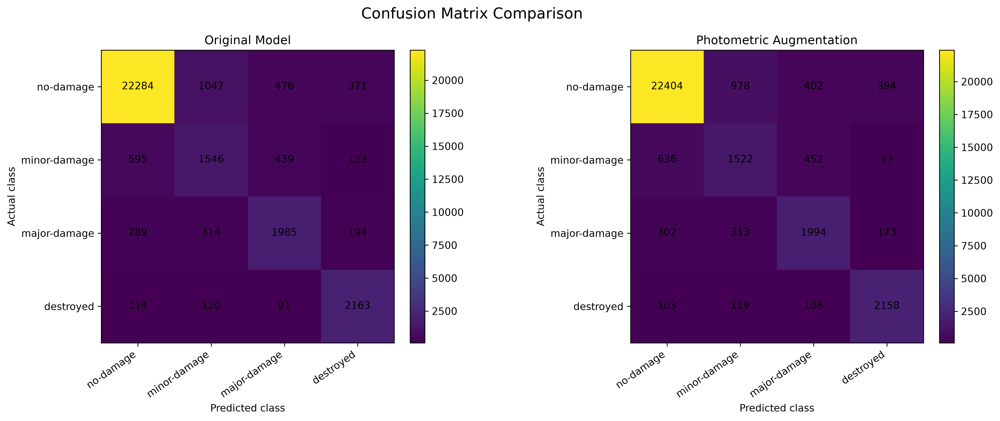
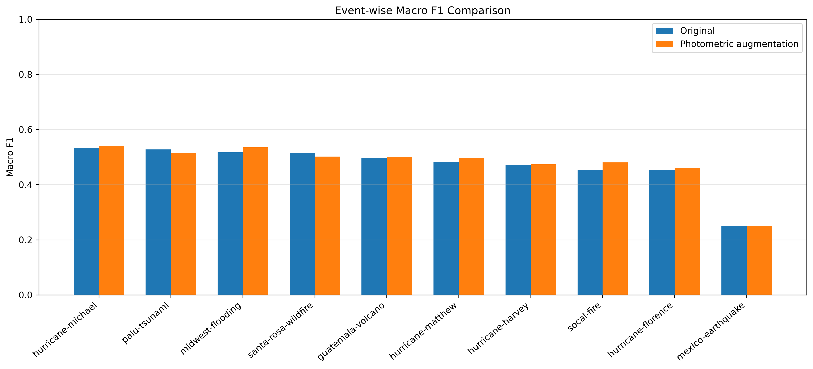
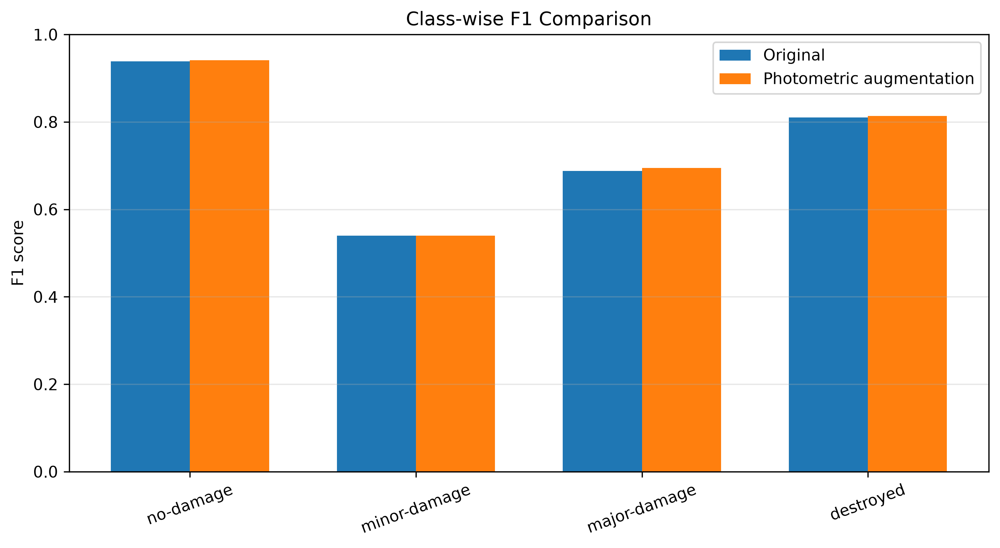
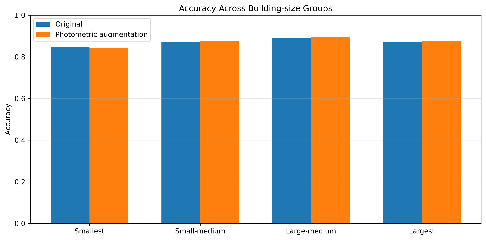
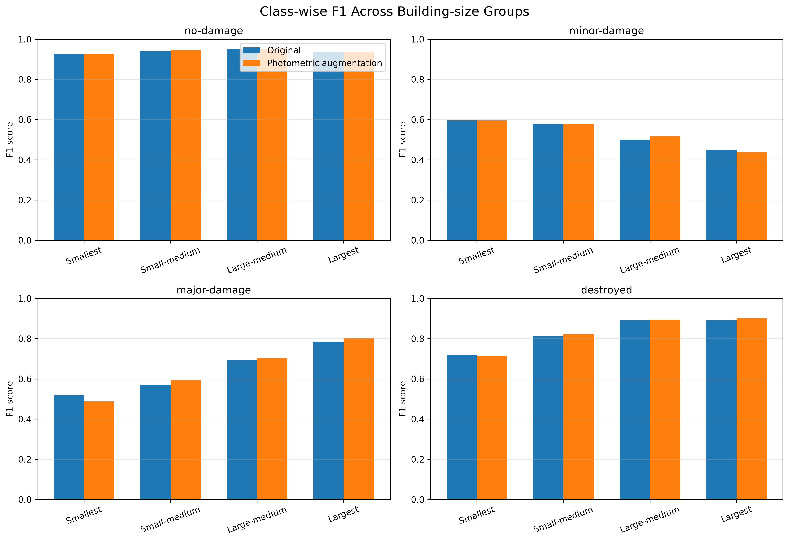
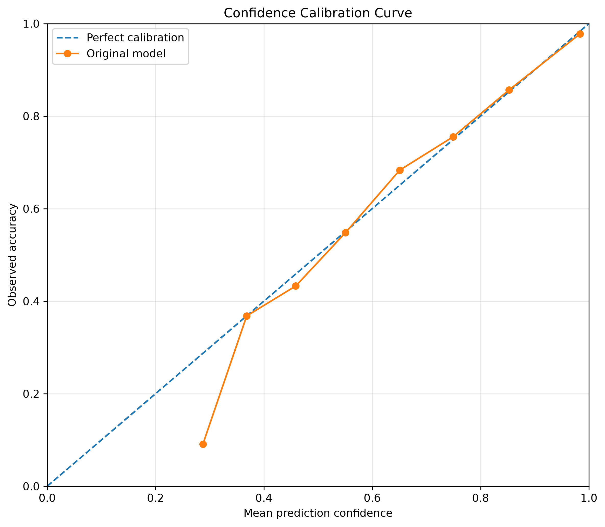

# Post-Disaster Damage Assessment from Satellite Imagery

## Final Experimental Results

**Report date:** 2026-11-16

## 1. Project overview

This project investigates building-level damage classification using
paired pre-disaster and post-disaster satellite imagery from the
xView2/xBD dataset.

A Siamese ResNet18 architecture extracts features from both images
using a shared backbone. The resulting feature representations are
combined and passed through a classification head to predict one of
four building damage categories:

- No damage
- Minor damage
- Major damage
- Destroyed

The task is building-level damage classification. It is not
pixel-level damage segmentation.

## 2. Dataset and evaluation methodology

- Dataset: xView2/xBD training data.
- Total validation buildings: 32,151.
- Validation scenes: 448.
- Validation split: scene-level, event-wise split.
- Random seed: 42.
- Validation ratio: 20%.
- Input: paired pre-disaster and post-disaster building crops.
- Model input resolution: 128 × 128 pixels per image.
- Number of damage classes: 4.

Both checkpoints were evaluated using the same validation records
and preprocessing pipeline.

## 3. Model architecture

The project uses a Siamese ResNet18 architecture with shared weights.

The two branches process pre-disaster and post-disaster building
crops. Each branch produces a 512-dimensional feature vector.

The feature fusion operation concatenates:

1. Pre-disaster features.
2. Post-disaster features.
3. Absolute feature difference.
4. Element-wise feature product.

The resulting 2,048-dimensional representation is passed through
a classification head:

- Linear: 2048 → 512
- Batch normalization
- ReLU
- Dropout (0.3)
- Linear: 512 → 128
- ReLU
- Dropout (0.2)
- Linear: 128 → 4

The model contains approximately 12.3 million parameters.

## 4. Experimental configurations

### 4.1 Original model

- Architecture: Siamese ResNet18.
- Optimizer: AdamW.
- Initial learning rate: 0.0001.
- Weight decay: 0.0001.
- Loss: weighted cross-entropy.
- Geometric augmentation: horizontal flip, vertical flip and
  rotations by multiples of 90 degrees.
- Best checkpoint: epoch 5.

Checkpoint:
`checkpoints_siamese/best_model.pth`

### 4.2 Photometric augmentation experiment

The experiment started from the original best checkpoint.

Additional synchronized brightness and contrast transformations
were applied to the paired pre-disaster and post-disaster crops.

- Brightness factor: 0.90–1.10.
- Contrast factor: 0.90–1.10.
- Learning rate: 0.00001.
- Optimizer: AdamW.
- Maximum epochs: 5.
- Early stopping: patience 2.
- Best checkpoint: epoch 1.

Checkpoint:
`checkpoints_photo_aug/best_photo_aug_model.pth`

The original checkpoint was preserved.

## 5. Global model comparison

| Model | Buildings | Accuracy | Macro F1 | Weighted F1 |
| --- | --- | --- | --- | --- |
| Original | 32151 | 87.02% | 0.7442 | 0.8738 |
| Photometric augmentation | 32151 | 87.33% | 0.7474 | 0.8761 |

### 5.1 Interpretation

The photometric augmentation experiment improved:

- Accuracy by approximately 0.31 percentage points.
- Macro F1 by approximately 0.0032.
- Weighted F1 by approximately 0.0023.

The improvement is measurable but modest.

## 6. Class-wise performance

| Class | Support | Original F1 | Augmented F1 | F1 Change | Original Recall | Augmented Recall |
| --- | --- | --- | --- | --- | --- | --- |
| no-damage | 24178 | 0.9391 | 0.9409 | +0.0018 | 92.17% | 92.66% |
| minor-damage | 2703 | 0.5396 | 0.5402 | +0.0006 | 57.20% | 56.31% |
| major-damage | 2782 | 0.6877 | 0.6950 | +0.0073 | 71.35% | 71.68% |
| destroyed | 2488 | 0.8103 | 0.8134 | +0.0032 | 86.94% | 86.74% |

### 6.1 Interpretation

- No-damage classification remains the strongest category.
- Destroyed-building classification performs comparatively well.
- Major-damage F1 improves from 0.6877 to 0.6950.
- Minor-damage remains the weakest category.

Minor-damage recall decreases from approximately 57.20% to 56.31%,
even though its precision increases.

Therefore, photometric augmentation does not resolve the
minor-damage classification difficulty.

## 7. Event-wise performance

| Event | Buildings | Original Accuracy | Augmented Accuracy | Accuracy Change | Original Macro F1 | Augmented Macro F1 | Macro F1 Change |
| --- | --- | --- | --- | --- | --- | --- | --- |
| guatemala-volcano | 145 | 97.93% | 98.62% | +0.69 pp | 0.4982 | 0.5000 | +0.0018 |
| hurricane-florence | 994 | 92.35% | 93.36% | +1.01 pp | 0.4530 | 0.4613 | +0.0083 |
| hurricane-harvey | 4744 | 80.27% | 80.63% | +0.36 pp | 0.4718 | 0.4738 | +0.0020 |
| hurricane-matthew | 2493 | 59.25% | 59.25% | +0.00 pp | 0.4823 | 0.4973 | +0.0149 |
| hurricane-michael | 4271 | 65.84% | 67.06% | +1.22 pp | 0.5319 | 0.5410 | +0.0091 |
| mexico-earthquake | 7347 | 99.62% | 99.67% | +0.05 pp | 0.2495 | 0.2496 | +0.0001 |
| midwest-flooding | 1455 | 95.40% | 95.40% | +0.00 pp | 0.5174 | 0.5353 | +0.0179 |
| palu-tsunami | 5324 | 93.16% | 93.26% | +0.09 pp | 0.5275 | 0.5145 | -0.0131 |
| santa-rosa-wildfire | 3428 | 97.02% | 97.14% | +0.12 pp | 0.5138 | 0.5021 | -0.0117 |
| socal-fire | 1950 | 93.74% | 94.10% | +0.36 pp | 0.4534 | 0.4807 | +0.0273 |

### 7.1 Event-level findings

- 8 of 10 events improved in macro F1.
- 2 of 10 events declined in macro F1.
- The response to photometric augmentation varies by disaster event.
- Event-level performance should not be interpreted as proof of
  domain shift without further investigation.

The event-wise results indicate that global performance improvements
can conceal event-specific deterioration.

## 8. Event-wise class performance

| Event | Class | Support | Original F1 | Augmented F1 | Change |
| --- | --- | --- | --- | --- | --- |
| guatemala-volcano | no-damage | 141 | 0.9929 | 1.0000 | +0.0071 |
| guatemala-volcano | minor-damage | 2 | 0.0000 | 0.0000 | +0.0000 |
| guatemala-volcano | major-damage | 0 | 0.0000 | 0.0000 | +0.0000 |
| guatemala-volcano | destroyed | 2 | 1.0000 | 1.0000 | +0.0000 |
| hurricane-florence | no-damage | 782 | 0.9612 | 0.9680 | +0.0068 |
| hurricane-florence | minor-damage | 19 | 0.0000 | 0.0000 | +0.0000 |
| hurricane-florence | major-damage | 188 | 0.8507 | 0.8771 | +0.0264 |
| hurricane-florence | destroyed | 5 | 0.0000 | 0.0000 | +0.0000 |
| hurricane-harvey | no-damage | 2594 | 0.8694 | 0.8734 | +0.0040 |
| hurricane-harvey | minor-damage | 385 | 0.1186 | 0.0897 | -0.0290 |
| hurricane-harvey | major-damage | 1714 | 0.8323 | 0.8383 | +0.0060 |
| hurricane-harvey | destroyed | 51 | 0.0667 | 0.0938 | +0.0271 |
| hurricane-matthew | no-damage | 606 | 0.3979 | 0.3860 | -0.0120 |
| hurricane-matthew | minor-damage | 1244 | 0.6971 | 0.6960 | -0.0012 |
| hurricane-matthew | major-damage | 240 | 0.1562 | 0.2112 | +0.0551 |
| hurricane-matthew | destroyed | 403 | 0.6781 | 0.6960 | +0.0179 |
| hurricane-michael | no-damage | 2759 | 0.7950 | 0.8068 | +0.0118 |
| hurricane-michael | minor-damage | 974 | 0.4830 | 0.4842 | +0.0011 |
| hurricane-michael | major-damage | 374 | 0.3627 | 0.3926 | +0.0300 |
| hurricane-michael | destroyed | 164 | 0.4869 | 0.4805 | -0.0065 |
| mexico-earthquake | no-damage | 7331 | 0.9981 | 0.9984 | +0.0003 |
| mexico-earthquake | minor-damage | 16 | 0.0000 | 0.0000 | +0.0000 |
| mexico-earthquake | major-damage | 0 | 0.0000 | 0.0000 | +0.0000 |
| mexico-earthquake | destroyed | 0 | 0.0000 | 0.0000 | +0.0000 |
| midwest-flooding | no-damage | 1362 | 0.9797 | 0.9801 | +0.0004 |
| midwest-flooding | minor-damage | 33 | 0.0513 | 0.0513 | +0.0000 |
| midwest-flooding | major-damage | 42 | 0.7529 | 0.7229 | -0.0300 |
| midwest-flooding | destroyed | 18 | 0.2857 | 0.3871 | +0.1014 |
| palu-tsunami | no-damage | 4376 | 0.9686 | 0.9688 | +0.0001 |
| palu-tsunami | minor-damage | 1 | 0.0000 | 0.0000 | +0.0000 |
| palu-tsunami | major-damage | 194 | 0.2763 | 0.2263 | -0.0500 |
| palu-tsunami | destroyed | 753 | 0.8652 | 0.8628 | -0.0024 |
| santa-rosa-wildfire | no-damage | 2608 | 0.9845 | 0.9847 | +0.0002 |
| santa-rosa-wildfire | minor-damage | 12 | 0.0000 | 0.0000 | +0.0000 |
| santa-rosa-wildfire | major-damage | 22 | 0.1212 | 0.0714 | -0.0498 |
| santa-rosa-wildfire | destroyed | 786 | 0.9494 | 0.9524 | +0.0030 |
| socal-fire | no-damage | 1619 | 0.9667 | 0.9691 | +0.0024 |
| socal-fire | minor-damage | 17 | 0.0000 | 0.1053 | +0.1053 |
| socal-fire | major-damage | 8 | 0.0000 | 0.0000 | +0.0000 |
| socal-fire | destroyed | 306 | 0.8469 | 0.8485 | +0.0016 |

This table provides class-level precision, recall and F1 comparisons
for every event. Small class supports should be interpreted cautiously.

## 9. Building-size analysis

Building size was calculated using the area of each building's
polygon bounding box:

`area = bounding_box_width × bounding_box_height`

The validation buildings were divided into four groups using fixed
area quartiles:

- Q1: 422.1419
- Q2: 968.7842
- Q3: 1849.5001

The same boundaries were used for both checkpoints.

### 9.1 Minor-damage performance by size

| Size Group | Minor Support | Original Minor F1 | Augmented Minor F1 | F1 Change | Original Accuracy | Augmented Accuracy |
| --- | --- | --- | --- | --- | --- | --- |
| Smallest | 773 | 0.5962 | 0.5960 | -0.0002 | 84.74% | 84.42% |
| Small-medium | 739 | 0.5796 | 0.5778 | -0.0019 | 87.10% | 87.61% |
| Large-medium | 565 | 0.5000 | 0.5170 | +0.0170 | 89.18% | 89.56% |
| Largest | 626 | 0.4499 | 0.4368 | -0.0131 | 87.15% | 87.75% |

### 9.2 Interpretation

The original model shows declining minor-damage F1 across the
four building-size groups.

The augmented model improves minor-damage F1 in the large-medium
group but declines in the largest group.

Building-size subgroup performance is descriptive and does not
establish that building size causes classification difficulty.

## 10. Error analysis

The original validation model produced 4,173 incorrect predictions
out of 32,151 buildings, corresponding to an error rate of 12.98%.

Class-wise error rates:

| Class | Errors | Error rate |
|---|---:|---:|
| No damage | 1,894 | 7.83% |
| Minor damage | 1,157 | 42.80% |
| Major damage | 797 | 28.65% |
| Destroyed | 325 | 13.06% |

The most frequent confusion was no-damage buildings being classified
as minor damage.

Minor damage was the most difficult class in the original model.

## 11. Confidence and calibration analysis

Original model findings:

- Expected Calibration Error (ECE): approximately 0.0080.
- Brier score: approximately 0.1901.
- Log loss: approximately 0.3757.
- Incorrect predictions with confidence of at least 0.80: 870.

Although overall calibration error is low, calibration varies
between disaster events. Hurricane Matthew showed substantially
higher event-specific calibration error.

Confidence should therefore not be treated as a guarantee of
prediction correctness.

## 12. Selective prediction analysis

At a confidence threshold of 0.80, the original model retained:

- Coverage: 73.63%.
- Accuracy among accepted predictions: 96.32%.
- Accepted predictions: 23,673.
- Predictions requiring review: 8,478.

This is a retrospective validation analysis. It does not establish
a deployment-ready confidence threshold.

## 13. Prediction-transition analysis

Building-level prediction transitions were saved in `comparison_results/prediction_changes/building_prediction_changes.csv`. The analysis previously established: 27,561 buildings correct under both models, 3,656 incorrect under both, 517 changed from incorrect to correct, and 417 changed from correct to incorrect. Net additional correct predictions: 100.

The augmentation experiment changes a subset of building predictions.
The overall improvement is modest rather than a complete change
in model behaviour.

## 14. Main findings

1. A Siamese ResNet18 model can classify four building damage
   categories from paired satellite imagery.
2. The original model achieves 87.02% validation accuracy and
   0.7442 macro F1.
3. Photometric augmentation improves validation accuracy to 87.33%
   and macro F1 to 0.7474.
4. Major-damage classification shows the largest global F1
   improvement.
5. Minor-damage classification remains the main weakness.
6. Performance varies considerably between disaster events.
7. Building-size subgroup analysis reveals different performance
   patterns across size groups.
8. Confidence-based selective prediction can reduce errors among
   accepted predictions, at the cost of reduced coverage.

## 15. Limitations

- No independent test dataset was available in the current project
  setup. Results are validation results, not independent test scores.
- The best checkpoint and augmentation experiment were selected
  using validation performance.
- The dataset contains four building-level damage categories.
- The system does not produce pixel-level damage segmentation.
- Event-level performance can vary substantially.
- The photometric augmentation improvement is modest.
- A single-scene inference demonstration cannot establish
  generalization to unseen disasters.
- Confidence scores do not guarantee prediction correctness.
- Building-size and image-statistics relationships are observational
  and do not establish causality.

## 16. Future improvements

- Evaluate on an independent disaster dataset or held-out test set.
- Investigate minor-damage classification using targeted experiments.
- Explore event-robust training and domain generalization.
- Investigate multi-scale building representations.
- Improve uncertainty estimation and confidence calibration.
- Develop a demonstration interface for paired satellite imagery.
- Evaluate performance on geographically and environmentally
  different disaster events.

## 17. Reproducibility and output files

Important project outputs:

- `comparison_results/original/validation_metrics.json`
- `comparison_results/photo_aug/validation_metrics.json`
- `comparison_results/event_comparison/event_metrics_comparison.csv`
- `comparison_results/event_comparison/event_class_metrics_comparison.csv`
- `comparison_results/event_comparison/event_confusion_comparison.csv`
- `building_size_comparison/building_size_metrics_comparison.csv`
- `comparison_results/prediction_changes/building_prediction_changes.csv`

The original and augmented checkpoints are stored separately.

---

## 18. Experimental visualizations

### 18.1 Overall model performance

### 18.2 Confusion matrices

### 18.3 Event-wise performance

### 18.4 Class-wise performance

### 18.5 Building-size accuracy

### 18.6 Class-wise performance by building size

### 18.7 Confidence calibration

---

**End of experimental results report.**
